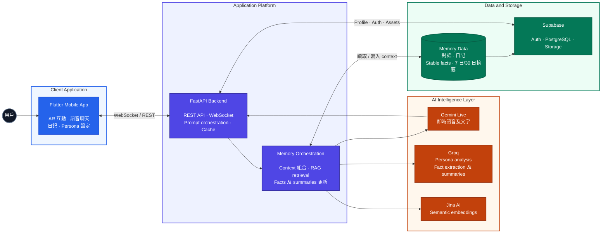

# AR Virtual Companion（FYP）

[](README.md)
[](README_zh.md)


一個結合 AR 角色互動、即時語音聊天、Persona 個人化、日記及 AI 記憶系統的手機 AI 伴侶應用程式。

本專案是 COMP S456F Final Year Project。

---

## Technical Highlights

- 使用 WebSocket 配合 Gemini Live，進行雙向即時語音串流。
- 在語音轉錄仍進行時預先搜尋 RAG memory，降低回應延遲。
- 將 Profile、Persona、對話、日記、Facts 及 summaries 組合成 dynamic system prompt。
- 使用 background process 抽取 stable facts，並建立 7 日／30 日 rolling summaries。
- Supabase database access 加入 thread-safe locking 及 transient connection retry。
- 使用 runtime cache、in-flight request deduplication 及 cache invalidation。
- 支援 AR avatar placement、動畫、object detection 及 Supabase Storage model loading。

## 🎥 示範影片

[](https://youtu.be/SFbLtfeLPjA)

[在 YouTube 觀看](https://youtu.be/SFbLtfeLPjA)

---

## 📸 應用程式截圖

以下展示 AR Virtual Companion 的主要介面及功能：

### 1. Onboarding 及個人化

<div align="center">
  
  
  
</div>
<div align="center">
  
  
  
</div>

### 2. Dashboard 及用戶資料

<div align="center">
  
  
  
</div>

### 3. AR 互動

<div align="center">
  
  
  
</div>

### 4. 日記及分析

<div align="center">
  
  
  
</div>

---

## 🚀 Demo 及部署

- **Backend API（Hugging Face）**：[Hugging Face Space Repository](https://huggingface.co/spaces/samlam123/Ai_companion/tree/main)
- **Database 及登入驗證**：Supabase

---

## 🏗️ 系統架構

本 repository 是一個 Monorepo，包含 Flutter frontend 及 Python FastAPI backend。

```text
.
├── ar_virtual_companion/                   # Flutter mobile app
│   ├── lib/                                # 前端程式碼
│   ├── assets/                             # 圖示及本地資源
│   └── pubspec.yaml
└── AI companion Backend hugging face space/ # FastAPI backend
    ├── main.py                             # API 入口
    ├── routes_*.py                         # Chat、Memory、Persona API
    ├── Dockerfile                          # Hugging Face deployment
    └── requirements.txt                    # Python dependencies
```

### System Architecture Diagram



### 系統資料流程

1. Flutter app 透過 Supabase Auth 登入，並載入 profile 及 3D avatar。
2. 用戶輸入文字或語音後，app 透過 WebSocket 傳送到 FastAPI backend。
3. Backend 讀取 profile、Persona 及相關 memory，組合 dynamic system prompt。
4. Gemini Live 產生即時文字及語音回覆，並串流返回 Flutter app。
5. 對話完成後，backend 將對話儲存至 Supabase。
6. Groq 定期從對話中抽取 stable facts 及 7 日／30 日摘要；Jina 將對話轉換成 embedding，供日後 RAG 搜尋。

---

## 🧠 AI 記憶系統

### Memory 系統究竟有幾多層？

本專案的 AI memory system 有 **6 個 contextual memory sources**。它們會在每次建立 chat prompt 時被讀取及組合。這 6 個來源不是單純由新到舊排列，而是各自負責不同類型的記憶。

| 層數 | Memory source | 儲存位置 | 用途 |
|---|---|---|---|
| 1 | Profile & Persona | `profiles`、`personas` | 用戶名稱、偏好、Persona、性格及溝通風格。 |
| 2 | Recent Conversation | `memories` | 保持最近對話的即時連貫性。 |
| 3 | Semantic Memories（RAG） | `memories`、Jina embeddings、`match_memories` | 根據目前問題，找出相關的舊對話。 |
| 4 | Daily Journal Context | `daily_logs` | 提供近期日記、情緒及生活記錄。 |
| 5 | Rolling Summaries | `memory_summaries` | 儲存 `recent_7d` 及 `recent_30d` 對話摘要。 |
| 6 | Stable Facts | `memory_facts` | 儲存從多次證據抽取出的長期 facts，並保留 confidence 及 evidence count。 |

另外，backend 有一個獨立的 **runtime cache**，暫存 profile 及 system prompt 以減低延遲。Runtime cache 是效能層，不是持久記憶，因此不計入上述 6 層。

### AI 如何使用記憶？

```text
目前用戶訊息
      │
      ├── 讀取 Profile / Persona
      ├── 讀取 Recent Conversation
      ├── 搜尋 Semantic Memories（RAG）
      ├── 讀取 Daily Journal Context
      ├── 讀取 7 日及 30 日 Summaries
      └── 讀取 Stable Facts
              │
              ▼
      Dynamic System Prompt
              │
              ▼
      Gemini Live 產生回覆
```

對話不會將所有歷史資料一次過放入 prompt。Backend 會按目前訊息搜尋相關 semantic memories，並以 summaries 及 stable facts 壓縮長期資訊，從而在保留個人化的同時控制 prompt 大小及回應延遲。

### Memory 更新流程

- 每次完成對話後，對話 turn 會寫入 `memories`。
- 系統定期使用 Groq 從最近對話抽取或更新 `memory_facts`。
- 系統定期產生 `recent_7d` 及 `recent_30d` summaries。
- Jina Embeddings 將對話轉換成向量，並透過 Supabase RPC `match_memories` 做 semantic retrieval。
- 用戶更新設定後，profile 及 system prompt runtime cache 會被 invalidate。

---

## 📱 Frontend（Flutter）

位置：`ar_virtual_companion/`

### 主要功能

- AR 角色放置、渲染及動畫。
- 從 Supabase Storage 下載及本地 cache 3D `.glb` avatar。
- 透過 WebSocket 進行低延遲語音及文字聊天。
- Profile、Persona 問答及 avatar onboarding。
- Daily journal、情緒標籤及 weekly/monthly insights。
- Push notifications、object detection、data export 及本地 cache。

### 安裝及執行

```bash
cd ar_virtual_companion
flutter pub get
flutter run
```

完整 AR 體驗建議使用支援 AR 的實體 Android 或 iOS 裝置。

---

## ⚙️ Backend（Python FastAPI）

位置：`AI companion Backend hugging face space/`

### 主要 API

- `GET /health`
- `GET /v1/chat/prepare?user_id=...&force_refresh=false`
- `WS /v1/chat/live?user_id=...`
- `POST /v1/memory/index/backfill`
- `GET /v1/memory/index/backfill/status`
- `GET /v1/check-comfort?user_id=...`
- `POST /v1/persona/analyze`

### 環境變數

| 變數 | 必需 | 用途 |
|---|---|---|
| `GEMINI_API_KEY` | 是 | Gemini Live 即時語音及文字回覆。 |
| `SUPABASE_URL` | 是 | Supabase database connection。 |
| `SUPABASE_KEY` | 是 | Supabase database connection。 |
| `GROQ_API_KEY` | 否（建議） | Persona analysis、memory facts、summaries 及 comfort messages。 |
| `JINA_API_KEY` | 否（建議） | Semantic memory embeddings。 |
| `MEMORY_ADMIN_KEY` | 否 | 保護 memory backfill admin API。 |

### 本地安裝及執行

```bash
cd "AI companion Backend hugging face space"
python -m venv .venv

# Windows PowerShell
.venv\Scripts\Activate.ps1

pip install -r requirements.txt
# 設定 .env 內的環境變數
uvicorn main:app --host 0.0.0.0 --port 8000 --reload
```

正式部署時，請在 Hugging Face Space settings 設定 backend environment variables。Supabase 必須設定 Row Level Security，確保不同用戶的 profile、日記及 memory 資料互相隔離。

---

## 🛠️ 技術棧

- **Frontend**：Flutter、Dart、Riverpod、Provider、`ar_flutter_plugin_2`
- **Backend**：Python 3.11、FastAPI、Uvicorn、WebSockets
- **AI / ML**：Gemini Live、Groq Llama 3、Jina Embeddings
- **Database / Storage**：Supabase PostgreSQL、Auth、Storage

## 📝 License

Academic use（FYP）project。
